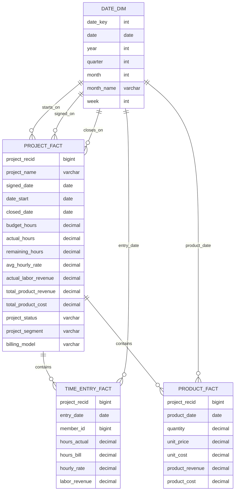

# Data model and relationship guidance

## Relationship rules

1. Use one active date relationship per Date table in Power BI.
2. Keep the other date relationships inactive.
3. Use `USERELATIONSHIP()` in DAX when you intentionally need a non-active relationship.
4. Keep `Project_RecID` as the join key between project, time entry, and product facts.
5. Build a standard date table in Power BI to support weekly and monthly reporting.

## Keys to use

- `Project_RecID` for project-to-time-entry and project-to-product relationships
- `Date` for month/week/quarter slicing
- `Project_Status` and `Project_Segment` for portal reporting

## Recommended Power BI measures

The most critical business measures are:
- Actual Revenue
- Forecast Revenue
- Open Pipeline Value
- Closed Revenue
- Product Revenue / Product Cost
- Budget Hours vs Actual Hours
- Forecast Gross Margin
